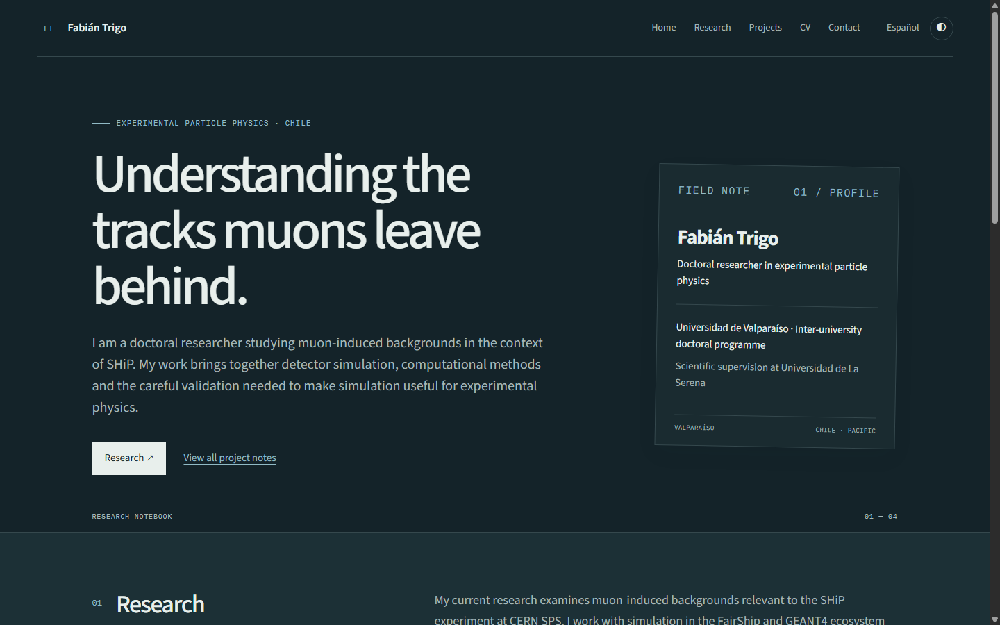
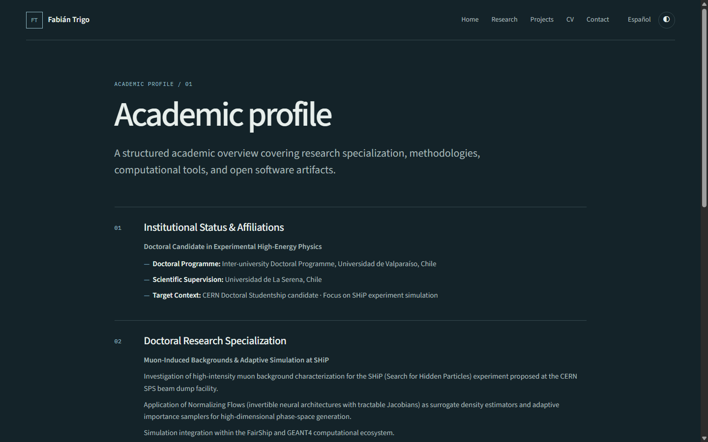
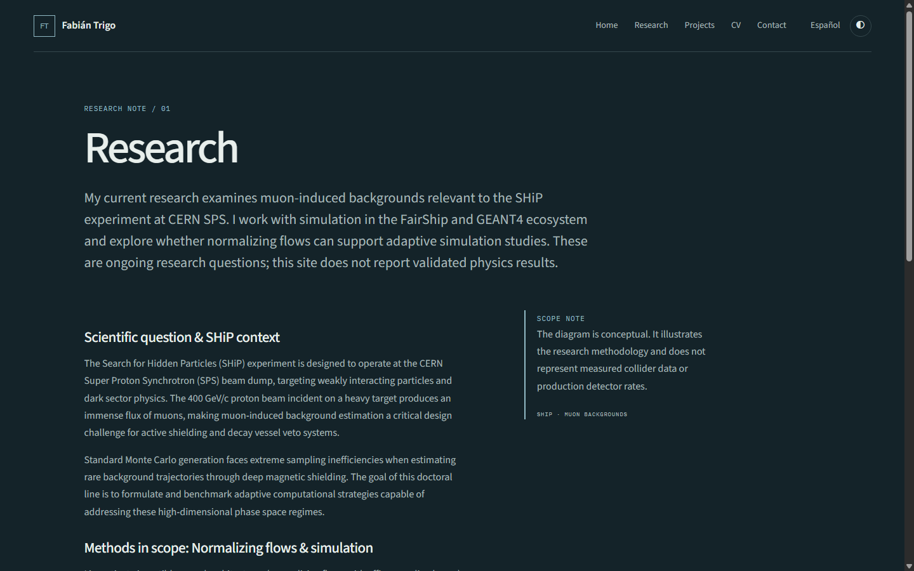
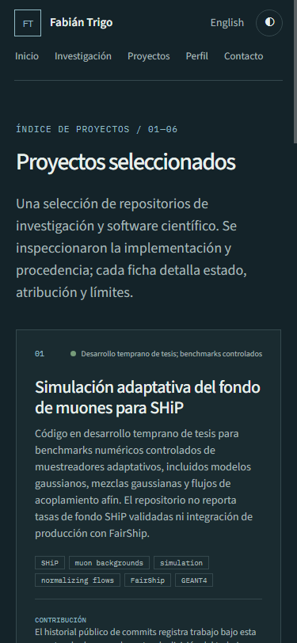
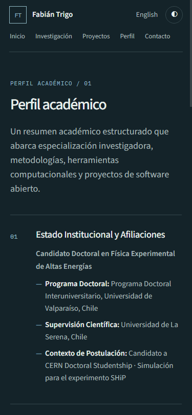

# Verification and visual preview

Automated verification and responsive visual checks completed on 2026-10-12:

- **Typecheck & Astro check**: `npm run check` passed on 23 project files with 0 errors, 0 warnings, and 0 hints.
- **Production static build**: `npm run build` generated 10 localized static pages (5 English, 5 Spanish) plus `sitemap.xml`.
- **Integrity test**: `node scripts/verify-build.mjs` verified localized counts, internal links, anchor targets, canonical URLs, hreflang links (including `x-default`), Open Graph metadata, assets and sitemaps for root hosting (`BASE_PATH=/` and origin `https://fbientrigo.github.io`).
- **Responsive & theme rendering**: Evaluated via headless Chrome DevTools Protocol (`scripts/capture-previews.mjs`) testing mobile (375x812), desktop (1440x900), and dark theme preferences. Zero horizontal overflow observed (`scrollWidth === innerWidth === 375px` in mobile viewports).

## Previews

### Desktop English Home

### Desktop English CV (Academic Profile)

### Desktop Dark Mode Research

### Mobile Spanish Projects (375px)

### Mobile Spanish CV (375px)

