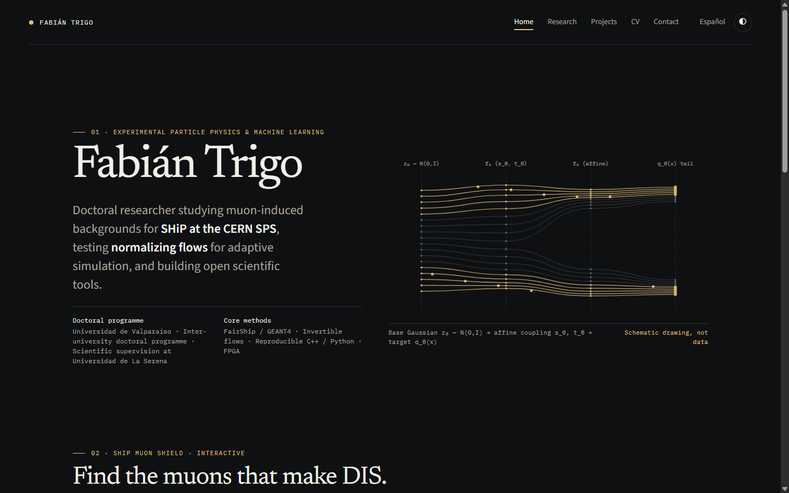
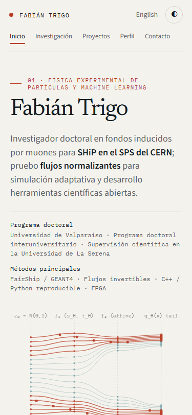

# Verification and visual preview

Automated verification and responsive visual checks completed on 2026-10-25:

- **Astro check**: `npm run build` checked 24 project files with 0 errors, warnings, or hints.
- **Production build and integrity**: `npm run build` generated 10 localized pages and `sitemap.xml`; `scripts/verify-build.mjs` verified internal links, anchors, canonical and alternate language URLs, SEO metadata, CSS assets, and sitemap for `https://fbientrigo.github.io/`.
- **Browser checks and previews**: `npm run preview:capture` passed on all seven desktop (1440×900) and mobile (375×812) previews, with no runtime JavaScript errors or horizontal overflow. The research controls passed Next, Reset, normal Play, and a switch to reduced motion while playing; no more than one animation frame was pending at once.

## Previews

### Desktop English Home (current)

### Desktop Dark Mode Home (current)

### Mobile Spanish Home (current)

### Desktop English CV (Academic Profile)

### Desktop Dark Mode Research

### Mobile Spanish Projects (375px)

### Mobile Spanish CV (375px)

